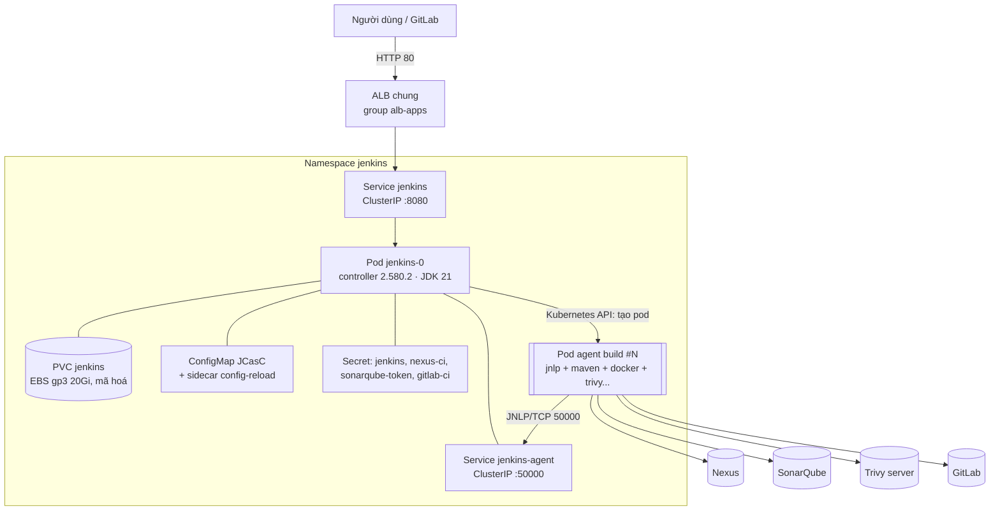

# 1. Kiến trúc Jenkins và các tuỳ chọn cấu hình

[← Mục lục](README.md)

## 1.1. Tổng quan

Jenkins chạy trên cụm EKS `eks-cluster-ver1` theo mô hình **controller + agent động (ephemeral agent)**:

- **Controller** (`jenkins-0`, StatefulSet 1 replica): lưu cấu hình, job, lịch sử build, điều phối build. **Không chạy build** (0 executor).
- **Agent**: mỗi build tạo một **pod Kubernetes riêng** qua plugin `kubernetes`. Pod chứa đúng các container build đó cần (JDK, Maven, docker, trivy…) và bị xoá khi build xong.

| Thành phần | Kubernetes object | Ghi chú |
|---|---|---|
| Controller | `StatefulSet/jenkins` (1 pod `jenkins-0`) | Image `jenkins/jenkins:2.580.2-jdk21` |
| Dữ liệu `JENKINS_HOME` | `PVC/jenkins` 20Gi, StorageClass `gp3` (EBS, `encrypted=true`) | Volume EBS gắn với một AZ |
| Web UI | `Service/jenkins` (ClusterIP 8080) + `Ingress/jenkins` (ALB `alb-apps`) | http://jenkins.gitlabonlinecom.click |
| Kết nối agent | `Service/jenkins-agent` (ClusterIP 50000) | Agent kết nối qua JNLP trong cụm |
| Cấu hình | ConfigMap JCasC + sidecar `config-reload` | Sửa ConfigMap thì JCasC tự nạp lại |
| Quyền Kubernetes | `ServiceAccount/jenkins` + Role/RoleBinding trong namespace `jenkins` | Chỉ quản lý pod agent; **không** đọc Secret (`rbac.readSecrets: false`) |
| Plugin | Cài lúc pod khởi động (init container `init`) | 127 plugin, đã ghim phiên bản |

### Vòng đời một build

1. GitLab có commit mới. Job Multibranch quét repo 5 phút một lần (hoặc nhận webhook).
2. Controller đọc `Jenkinsfile`, gọi Kubernetes API để tạo pod agent theo `podTemplate`.
3. Container `jnlp` trong pod kết nối về `jenkins-agent:50000`. Controller giao các bước cho agent.
4. Các container trong pod dùng chung workspace (`emptyDir`) và chạy các stage.
5. Build xong thì pod bị xoá (`podRetention: Never`). Log, kết quả test và artifact được lưu trên controller.

**Vì sao dùng agent động:** mỗi build có môi trường sạch và độc lập; không phải bảo trì máy build; tài nguyên chỉ dùng khi có build; Cluster Autoscaler tự thêm node khi nhiều build chạy cùng lúc.

## 1.2. Các nhóm cấu hình và ý nghĩa

Cấu hình nằm trong `helm-install/jenkins/jenkins/values.yaml` (chart `jenkins` 5.8.116). Bảng dưới ghi **giá trị đang triển khai**.

### Controller

| Khoá | Giá trị | Ý nghĩa |
|---|---|---|
| `controller.image.tag` | `2.580.2-jdk21` | Jenkins LTS 2.580.2. Chart mặc định 2.528.3 có 6 cảnh báo bảo mật core, nên đã ghi đè |
| `controller.numExecutors` | `0` | Không chạy build trên controller: an toàn (build không đọc được `JENKINS_HOME`) và ổn định |
| `controller.javaOpts` | `-Xms512m -Xmx1024m` | Heap JVM. Phải nhỏ hơn giới hạn RAM của container |
| `controller.resources` | requests 50m / 256Mi, limits 2 CPU / 4Gi | Tài nguyên pod controller (xem [Sizing](02-sizing.md)) |
| `controller.jenkinsUrl` | `http://jenkins.gitlabonlinecom.click` | URL gốc Jenkins dùng trong link, webhook, email |
| `controller.probes.startupProbe.failureThreshold` | `30` | Cho phép khởi động tới 5 phút (30 × 10 giây), vì lúc khởi động phải cài lại plugin |
| `controller.serviceType` | `ClusterIP` | Không mở cổng ra ngoài; chỉ truy cập qua Ingress |
| `controller.agentListenerServiceType` | `ClusterIP` | Cổng JNLP 50000 chỉ mở trong cụm |
| `controller.runAsUser` / `fsGroup` | `1000` / `1000` | Chạy bằng user không phải root |
| `controller.containerSecurityContext` | `readOnlyRootFilesystem: true`, `allowPrivilegeEscalation: false` | Hạn chế quyền của container controller |
| `controller.disableRememberMe` | `false` | Có tuỳ chọn "Remember me" khi đăng nhập. Môi trường PCI DSS nên để `true` |

### Plugin

| Khoá | Giá trị | Ý nghĩa |
|---|---|---|
| `controller.installPlugins` | 22 plugin chính + 102 dependency, **ghim đúng phiên bản** | Mỗi lần khởi động cài đúng bộ plugin đã kiểm chứng |
| `controller.installLatestPlugins` | `false` | Không tự lấy dependency mới nhất |
| `controller.overwritePlugins` | `true` | Danh sách trong values là chuẩn duy nhất; plugin cài tay trên giao diện sẽ bị gỡ khi khởi động lại |
| `controller.initializeOnce` | `false` | Cài plugin ở mọi lần khởi động. Đổi lại, khởi động lâu hơn (khoảng 4–5 phút) |

Danh sách 22 plugin chính và lý do dùng:

| Nhóm | Plugin | Dùng cho |
|---|---|---|
| Lõi | `kubernetes`, `workflow-aggregator`, `configuration-as-code`, `matrix-auth` | Agent động, Pipeline, JCasC, phân quyền |
| SCM | `git`, `gitlab-branch-source` | Checkout, Multibranch với GitLab |
| Hỗ trợ pipeline | `pipeline-utility-steps`, `config-file-provider`, `timestamper`, `ansicolor`, `ws-cleanup`, `pipeline-graph-view`, `pipeline-stage-view` | `readMavenPom`/`readYaml`, file cấu hình, log, giao diện pipeline |
| Chất lượng / bảo mật | `sonar`, `junit`, `coverage`, `warnings-ng`, `htmlpublisher` | SonarQube + Quality Gate, test, coverage, báo cáo phân tích tĩnh |
| Kubernetes / AWS | `kubernetes-cli`, `aws-credentials`, `pipeline-aws` | `kubectl`, thao tác AWS |
| Thông báo | `email-ext` | Gửi email kết quả build |

### Bảo mật

| Khoá | Giá trị | Ý nghĩa |
|---|---|---|
| JCasC `securityRealm` | `local`, `allowsSignup: false` | Tài khoản cục bộ, không cho tự đăng ký |
| JCasC `authorizationStrategy` | `loggedInUsersCanDoAnything`, `allowAnonymousRead: false` | Đăng nhập là có toàn quyền; người chưa đăng nhập không xem được gì. **Chỉ phù hợp khi có 1 admin** (xem [phần 3](03-tich-hop-va-bao-mat.md)) |
| `controller.csrf.defaultCrumbIssuer` | `enabled: true`, `proxyCompatability: true` | Chống CSRF; tương thích khi chạy sau ALB |
| `controller.enableRawHtmlMarkupFormatter` / `markupFormatter` | `false` / `plainText` | Không render HTML trong mô tả job, chống XSS |
| `rbac.readSecrets` | `false` | Service account của Jenkins không đọc được Kubernetes Secret |
| `controller.admin` | Secret `jenkins` (`jenkins-admin-user`, `jenkins-admin-password`) | Mật khẩu admin tạo ngẫu nhiên lúc cài, đổi bằng `kubectl patch` |
| `controller.additionalExistingSecrets` | `nexus-ci`, `sonarqube-token`, `gitlab-ci` | Mount Secret vào `/run/secrets/additional`; JCasC đọc qua biến `${<tên>-<key>}` |

### JCasC (Jenkins Configuration as Code)

Cấu hình hệ thống được khai báo bằng YAML trong `controller.JCasC`, không bấm tay trên giao diện:

| Script | Nội dung |
|---|---|
| Mặc định của chart (`defaultConfig: true`) | Security realm, authorization, Kubernetes cloud, agent template mặc định, Jenkins URL |
| `welcome-message` | Thông báo trên trang chủ |
| `ci-integrations` | 4 credentials (`nexus-creds`, `docker-user-internal`, `sonarqube-token`, `gitlab-token-dev-group`) + SonarQube server `SonarQube` |

Sidecar `config-reload` theo dõi ConfigMap JCasC. Khi sửa values rồi `helm upgrade`, cấu hình được nạp lại mà không cần khởi động lại Jenkins (trừ khi đổi plugin hoặc Secret).

### Agent (Kubernetes cloud)

| Khoá | Giá trị | Ý nghĩa |
|---|---|---|
| `agent.image` | `jenkins/inbound-agent:3355.v388858a_47b_33-3-jdk21` | Container `jnlp` mặc định; **phải là JDK 21**, cùng Java với controller |
| `agent.resources` | 512m CPU / 512Mi | Tài nguyên mặc định của `jnlp` (Jenkinsfile có thể ghi đè) |
| `agent.podRetention` | `Never` | Xoá pod sau build |
| `agent.containerCap` | `10` | Tối đa 10 pod agent dùng template mặc định cùng lúc |
| `agent.connectTimeout` | `100` giây | Thời gian chờ agent kết nối |
| `agent.namespace` | trống (= `jenkins`) | Pod agent chạy cùng namespace với controller |

Các pipeline khai báo `podTemplate` riêng trong `Jenkinsfile` (ví dụ `shopping-cart` dùng 5 container `jnlp`, `maven`, `maven17`, `docker`, `trivy`).

### Lưu trữ và mạng

| Khoá | Giá trị | Ý nghĩa |
|---|---|---|
| `persistence.storageClass` / `size` | `gp3` / `20Gi` | EBS gp3, mã hoá; chứa `JENKINS_HOME` (job, lịch sử build, artifact) |
| `controller.ingress` | ALB, group `alb-apps`, HTTP 80, `healthcheck-path: /login` | Dùng chung ALB với GitLab và các app khác. `/` trả 403 khi chưa đăng nhập nên health check dùng `/login` |
| `networkPolicy.enabled` | `false` | Chưa giới hạn traffic giữa các pod (nên bật khi áp dụng PCI DSS) |
