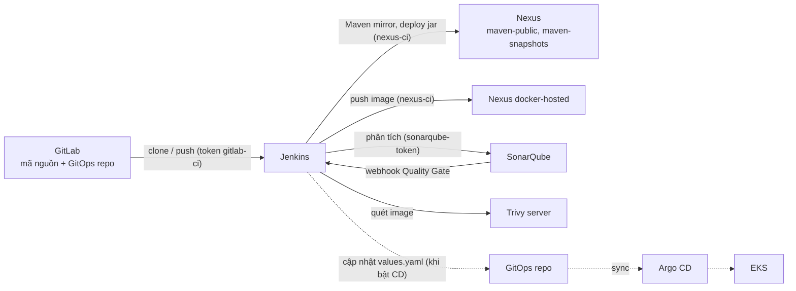

# 3. Tích hợp với các DevOps tool khác, bảo mật và tuân thủ (PCI DSS)

[← Mục lục](README.md)

## 3.1. Bản đồ tích hợp



| Tool | Jenkins gọi tới | Xác thực | Cấu hình phía Jenkins | Cấu hình phía tool |
|---|---|---|---|---|
| **GitLab** | `http://gitlab.gitlabonlinecom.click/<group>/<repo>.git` | Group access token (role Maintainer, scope `read_repository`, `write_repository`) | Credential `gitlab-token-dev-group` (từ Secret `gitlab-ci`); job Multibranch, quét 5 phút | Tạo token trong group `devops`; (tuỳ chọn) webhook push tới Jenkins |
| **Nexus (Maven)** | `http://nexus.nexus.svc.cluster.local:8081/repository/maven-public/` | User `ci-jenkins` (role `ci-role`) | Credential `nexus-creds`; `settings.xml` sinh trong pipeline, mirror `*` | `helm-install/nexus/bootstrap.sh` tạo role và user |
| **Nexus (Docker)** | `docker-internal.gitlabonlinecom.click` (repo `docker-hosted`, cổng 8000) | User `ci-jenkins` | Credential `docker-user-internal` | Bật realm Docker Bearer Token; repo hosted/proxy/group |
| **SonarQube** | `http://sonarqube-sonarqube.sonarqube.svc.cluster.local:9000` | Global Analysis Token | Server `SonarQube` (JCasC) + credential `sonarqube-token` | `helm-install/sonarqube/bootstrap.sh` tạo token và webhook về `http://jenkins.jenkins.svc.cluster.local:8080/sonarqube-webhook/` |
| **Trivy** | `http://trivy.trivy.svc.cluster.local:9090` | Không (chỉ truy cập trong cụm) | Container `trivy` trong pod agent, chạy client/server | Chart `helm-install/trivy-scanner` |
| **Argo CD** (CD, chưa bật) | Không gọi trực tiếp: Jenkins push GitOps repo, Argo CD tự đồng bộ | Token `gitlab-ci` | `GITOPS_ENABLED`, `GITOPS_REPO_URL` trong Jenkinsfile | Application trỏ tới GitOps repo |
| **AWS** | AWS API (ECR, S3…) | **IRSA** (khuyến nghị) hoặc `aws-credentials` | Service account của pod agent gắn IAM role | IAM role có trust với OIDC của EKS |

### Nguyên tắc tích hợp

- **Mỗi tool một tài khoản kỹ thuật, quyền tối thiểu.** Ví dụ `ci-jenkins` chỉ đọc `maven-public`/`docker-group` và deploy vào 3 repo; token GitLab chỉ có quyền repository.
- **Secret không nằm trong git và không đi qua giao diện web:** script bootstrap tạo Kubernetes Secret, JCasC đọc Secret thành credential.
- **Gọi tool qua địa chỉ trong cụm** (`*.svc.cluster.local`): traffic không ra ALB, nhanh hơn và không lộ ra Internet.
- **Thêm một tool mới:** tạo tài khoản kỹ thuật → tạo Secret trong namespace `jenkins` → thêm vào `controller.additionalExistingSecrets` → khai báo credential trong JCasC script `ci-integrations` → `helm upgrade`.

Ví dụ thêm credential Slack:

```yaml
controller:
  additionalExistingSecrets:
    - name: slack-ci
      keyName: token
  JCasC:
    configScripts:
      ci-integrations: |
        credentials:
          system:
            domainCredentials:
              - credentials:
                  # ...các credential hiện có...
                  - string:
                      scope: GLOBAL
                      id: slack-token
                      secret: "${slack-ci-token}"
```

## 3.2. Hiện trạng bảo mật

Kiểm tra bằng `helm-install/jenkins/security-audit/run.sh` (chỉ đọc). Lần chạy gần nhất:

| Hạng mục | Trạng thái |
|---|---|
| Phiên bản core | ✅ 2.580.2 (LTS), không có cảnh báo bảo mật |
| Plugin | ✅ 124 plugin ghim phiên bản, không có cảnh báo, không có bản cập nhật chờ |
| Đăng ký tài khoản | ✅ Tắt |
| Truy cập ẩn danh | ✅ Không được xem gì |
| CSRF | ✅ Bật |
| Build trên controller | ✅ 0 executor |
| HTML trong mô tả | ✅ Plain text |
| Jenkins đọc Kubernetes Secret | ✅ Không (`rbac.readSecrets: false`) |
| Credentials | ✅ Từ Kubernetes Secret, không lưu trong git |
| Container controller | ✅ Non-root, root filesystem chỉ đọc, không leo thang quyền |
| **HTTPS** | ❌ Chỉ HTTP; mật khẩu và session đi dạng plain text |
| **Phân quyền** | ⚠️ `loggedInUsersCanDoAnything`: ai đăng nhập cũng là admin |
| **MFA / SSO** | ❌ Tài khoản cục bộ, không có MFA |
| **Audit log** | ❌ Chưa ghi nhận ai làm gì (chưa có plugin Audit Trail) |
| **NetworkPolicy** | ❌ Chưa giới hạn traffic giữa các namespace |
| Pod agent `docker:dind` | ⚠️ Chạy privileged |

## 3.3. Lộ trình hardening

Các bước xếp theo thứ tự ưu tiên. Mỗi bước kèm cấu hình mẫu.

**1. Bật HTTPS cho ALB** bằng chứng chỉ ACM, dùng chung cho mọi app trong group `alb-apps`:

```yaml
controller:
  jenkinsUrl: "https://jenkins.gitlabonlinecom.click"
  ingress:
    annotations:
      alb.ingress.kubernetes.io/listen-ports: '[{"HTTP": 80}, {"HTTPS": 443}]'
      alb.ingress.kubernetes.io/certificate-arn: arn:aws:acm:ap-southeast-1:<account>:certificate/<id>
      alb.ingress.kubernetes.io/ssl-redirect: "443"
      alb.ingress.kubernetes.io/ssl-policy: ELBSecurityPolicy-TLS13-1-2-2021-06
```

Mọi Ingress trong cùng group phải khai báo listen-ports và certificate **giống nhau**; nếu lệch, LB Controller từ chối cả group.

**2. SSO + MFA:** dùng plugin `oic-auth` (OpenID Connect) với GitLab hoặc IdP của công ty (Keycloak, Azure AD, Okta). MFA được bắt buộc ở phía IdP.

```yaml
controller:
  JCasC:
    securityRealm: |-
      oic:
        clientId: "${oidc-client-id}"
        clientSecret: "${oidc-client-secret}"
        wellKnownOpenIDConfigurationUrl: "https://gitlab.gitlabonlinecom.click/.well-known/openid-configuration"
        userNameField: "preferred_username"
        groupsFieldName: "groups"
```

Plugin `oic-auth` cần được thêm vào `installPlugins` (và ghim phiên bản). Tên các trường JCasC có thể khác nhau giữa các phiên bản plugin: kiểm tra trang `/manage/configuration-as-code/reference` trên Jenkins trước khi áp dụng.

**3. Phân quyền theo vai trò** với plugin `matrix-auth` (đã cài). Gán quyền theo **nhóm** của IdP, không gán theo từng người:

```yaml
controller:
  JCasC:
    authorizationStrategy: |-
      globalMatrix:
        entries:
          - group:
              name: "devops/jenkins-admins"
              permissions: ["Overall/Administer"]
          - group:
              name: "devops/developers"
              permissions: ["Overall/Read", "Job/Read", "Job/Build", "Job/Cancel", "View/Read"]
          - group:
              name: "devops/auditors"
              permissions: ["Overall/Read", "Job/Read", "View/Read"]
```

**4. Audit log:** cài plugin `audit-trail` để ghi lại đăng nhập, thay đổi cấu hình và build, rồi đẩy log ra hệ thống tập trung (Fluent Bit → CloudWatch Logs hoặc ELK). Log được lưu ít nhất 12 tháng.

**5. NetworkPolicy:** chỉ cho phép các luồng cần thiết:
- ALB → `jenkins:8080`;
- pod agent → `jenkins-agent:50000`;
- pod agent → Nexus, SonarQube, Trivy, GitLab;
- controller → Kubernetes API.

Bật `networkPolicy.enabled: true` trong chart cho phần của Jenkins, và viết thêm policy cho namespace build.

**6. Giảm quyền của pod agent:** thay `docker:dind` privileged bằng **BuildKit rootless** hoặc Kaniko. Đặt `securityContext` non-root cho các container build. Áp dụng Pod Security Admission mức `baseline` hoặc `restricted` cho namespace build.

**7. Khác:**
- `disableRememberMe: true`;
- session hết hạn sau 15 phút không hoạt động (PCI DSS 8.2.8): `controller.jenkinsOpts: "--sessionTimeout=15"` (tham số của Winstone, tính bằng phút);
- giới hạn Script Console chỉ cho nhóm admin;
- không cho job ghi đè credential của hệ thống.

## 3.4. Đối chiếu PCI DSS v4.0.1

PCI DSS áp dụng khi pipeline build và deploy phần mềm thuộc hoặc kết nối với **môi trường dữ liệu chủ thẻ (CDE)**. Jenkins khi đó là **system component in scope**, vì nó có quyền đưa code vào CDE. Bảng dưới đối chiếu các yêu cầu liên quan trực tiếp đến CI/CD.

| Yêu cầu PCI DSS v4.0.1 | Nội dung | Jenkins / pipeline đáp ứng bằng | Trạng thái |
|---|---|---|---|
| **1.2, 1.3** – Kiểm soát kết nối mạng | Giới hạn traffic vào/ra CDE | Service ClusterIP; NetworkPolicy; tách cụm hoặc VPC build khỏi CDE | ⚠️ Chưa có NetworkPolicy |
| **2.2** – Cấu hình an toàn | Hardening, tắt chức năng không cần | Không build trên controller, CSRF, plain text markup, non-root, bộ plugin tối thiểu và ghim phiên bản | ✅ |
| **3.5, 3.6** – Bảo vệ khoá và dữ liệu lưu trữ | Mã hoá dữ liệu nhạy cảm khi lưu | EBS gp3 `encrypted=true`; credential Jenkins mã hoá bằng master key trong `JENKINS_HOME`; Kubernetes Secret (nên bật KMS envelope encryption cho EKS) | ✅ / ⚠️ kiểm tra KMS cho Secret |
| **4.2.1** – Mã hoá khi truyền | TLS mạnh trên mạng mở | HTTPS ALB + ACM, TLS 1.2+ | ❌ Đang dùng HTTP |
| **6.2.1–6.2.4** – Phát triển phần mềm an toàn | Quy trình phát triển an toàn, review code, chống lỗ hổng phổ biến | SonarQube Quality Gate (Sonar way, chặn issue và hotspot mới), Merge Request bắt buộc review trên GitLab, unit test | ✅ Gate / ⚠️ cần bắt buộc MR review |
| **6.3.1** – Nhận diện lỗ hổng | Theo dõi lỗ hổng của component | Trivy quét image, Sonar quét mã, audit Jenkins (core + plugin) | ✅ |
| **6.3.2** – Danh mục phần mềm | Inventory phần mềm bespoke và bên thứ ba | SBOM (Trivy `--format cyclonedx`), lưu theo từng release | ⚠️ Chưa sinh SBOM |
| **6.3.3** – Vá lỗ hổng | Lỗ hổng critical vá trong 1 tháng | Ghim plugin + quy trình nâng cấp hằng tháng; `TRIVY_EXIT_CODE=1` chặn image có lỗi HIGH/CRITICAL | ⚠️ Trivy chưa chặn (app cũ) |
| **6.4** – Ứng dụng web công khai | Bảo vệ trước tấn công | WAF trên ALB cho app (ngoài phạm vi Jenkins) | — |
| **6.5.1–6.5.6** – Quản lý thay đổi | Thay đổi có phê duyệt, tách prod và non-prod, không dùng dữ liệu thật để test | Pipeline có bước **phê duyệt** (`input`) trước staging/prod, môi trường tách theo nhánh, GitOps có lịch sử thay đổi, chỉ deploy image đã qua gate | ✅ thiết kế / ⏸ CD chưa bật |
| **7.2** – Quyền tối thiểu | Cấp quyền theo vai trò | `matrix-auth` theo nhóm; tài khoản kỹ thuật quyền tối thiểu (`ci-jenkins`, token GitLab) | ⚠️ Hiện ai đăng nhập cũng là admin |
| **8.2.1, 8.2.2** – ID riêng, không dùng chung tài khoản | Mỗi người một tài khoản | SSO; không dùng chung `admin` | ❌ Đang dùng `admin` |
| **8.3.6** – Mật khẩu | Tối thiểu 12 ký tự | Mật khẩu ngẫu nhiên; chính sách mật khẩu ở IdP | ✅ admin / ⚠️ khi thêm user |
| **8.4.2** – MFA | MFA cho mọi truy cập vào CDE | SSO có MFA | ❌ |
| **8.6.1–8.6.3** – Tài khoản hệ thống | Quản lý tài khoản ứng dụng, không viết cứng mật khẩu | Secret trong Kubernetes, credential binding (không in ra log), xoay token định kỳ | ✅ / ⚠️ cần lịch xoay token |
| **10.2** – Audit log | Ghi lại hành động của người dùng và admin | Plugin `audit-trail`, log Kubernetes API (EKS control plane logging) | ❌ |
| **10.5.1** – Lưu log | 12 tháng, 3 tháng gần nhất truy xuất ngay | CloudWatch Logs hoặc S3 có retention | ❌ |
| **10.6** – Đồng bộ thời gian | Thời gian chuẩn | Node EKS dùng Amazon Time Sync | ✅ |
| **11.3** – Quét lỗ hổng định kỳ | Quét nội bộ hằng quý | Lịch quét image (Trivy) và hạ tầng | ⚠️ Mới quét khi build |
| **11.5.2** – Phát hiện thay đổi | Cảnh báo khi file quan trọng bị sửa | Toàn bộ cấu hình Jenkins là code (Helm + JCasC); `overwritePlugins` gỡ plugin cài tay | ✅ một phần |
| **12.x** – Chính sách | Quy trình, đào tạo, phân công | Tài liệu này + quy trình nâng cấp và review | ⚠️ |

**Ưu tiên để đạt mức tối thiểu cho CDE:** HTTPS (4.2.1) → SSO + MFA + bỏ tài khoản dùng chung (8.2, 8.4) → phân quyền theo vai trò (7.2) → audit log + lưu 12 tháng (10.2, 10.5) → NetworkPolicy (1.x) → Trivy chặn HIGH/CRITICAL và sinh SBOM (6.3).

Ngoài PCI DSS, các yêu cầu trên cũng khớp với **CIS Kubernetes Benchmark** (pod non-root, NetworkPolicy, Secret), **NIST SSDF (SP 800-218)** (PS: bảo vệ code và pipeline; PW: quét và review; RV: xử lý lỗ hổng) và **SLSA** (build trên nền tảng tách biệt, có provenance).
