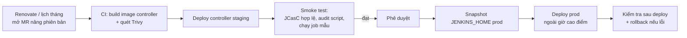

# 6. Vận hành và tự động hoá Jenkins controller (enterprise)

[← Mục lục](README.md)

Phần này mô tả cách vận hành Jenkins controller ở quy mô enterprise, và cách **tự động hoá các việc vận hành** để giảm thao tác tay và giảm rủi ro. Cấu hình hiện tại trên `eks-cluster-ver1` là mức lab; các mục đánh dấu **[Hiện có]** đã có sẵn trong repo, các mục khác là hướng phát triển tiếp.

## 6.1. Mô hình vận hành

### Nguyên tắc

1. **Mọi thứ là code, không cấu hình tay trên giao diện.** Mỗi lớp cấu hình có một nguồn chuẩn duy nhất:

   | Lớp | Nguồn chuẩn | Trạng thái |
   |---|---|---|
   | Hạ tầng | Terraform | [Hiện có] |
   | Controller | Helm values | [Hiện có] |
   | Cấu hình hệ thống | JCasC | [Hiện có] |
   | Plugin | Danh sách ghim phiên bản | [Hiện có] |
   | Job | Multibranch/Organization Folder + Job DSL | Cần bổ sung |
   | Pipeline dùng chung | Shared Library | Cần bổ sung |

2. **Controller là "cattle", không phải "pet"**: xoá đi tạo lại được bất cứ lúc nào. Thứ duy nhất cần sao lưu là lịch sử build trên `JENKINS_HOME`.
3. **Thay đổi đi qua pipeline**: nâng cấp core hoặc plugin, đổi cấu hình đều qua Merge Request → kiểm tra tự động → staging → production.
4. **Tách controller theo team hoặc sản phẩm** khi vượt ngưỡng ở [phần 2](02-sizing.md), để khi một controller có sự cố thì không ảnh hưởng toàn bộ.

### Vai trò

| Vai trò | Trách nhiệm |
|---|---|
| **Platform team** (chủ sở hữu Jenkins) | Nâng cấp, bảo mật, sao lưu, giám sát, Shared Library, onboarding team |
| **Team phát triển** | `Jenkinsfile` của repo mình; dùng Shared Library; báo lỗi pipeline |
| **Security / Compliance** | Duyệt thay đổi quyền và plugin mới; kiểm tra audit log; đánh giá PCI DSS định kỳ |
| **On-call** | Xử lý cảnh báo theo runbook ([mục 6.5](#65-runbook-sự-cố)) |

### Mục tiêu dịch vụ (SLO gợi ý)

| Chỉ số | Mục tiêu |
|---|---|
| Giao diện và API khả dụng | ≥ 99.5% / tháng (Jenkins OSS một controller có downtime khoảng 5 phút mỗi lần khởi động lại) |
| Thời gian chờ build (từ lúc vào hàng đợi đến khi chạy) | p95 < 2 phút |
| RPO (mất dữ liệu tối đa) | ≤ 24 giờ (snapshot hằng ngày); ≤ 1 giờ nếu snapshot hằng giờ |
| RTO (khôi phục) | ≤ 1 giờ |
| Vá lỗ hổng critical (core/plugin) | ≤ 7 ngày (PCI DSS 6.3.3 yêu cầu ≤ 1 tháng) |

## 6.2. Lịch vận hành định kỳ

| Tần suất | Việc | Tự động bằng |
|---|---|---|
| **Liên tục** | Theo dõi khả dụng, heap, queue, pod Pending, dung lượng | Prometheus + cảnh báo ([6.4.4](#644-giám-sát-và-cảnh-báo)) |
| **Hằng ngày** | Snapshot `JENKINS_HOME`; kiểm tra cảnh báo bảo mật của core và plugin | AWS Backup/DLM ([6.4.5](#645-sao-lưu-và-kiểm-tra-khôi-phục)); job `jenkins-security-audit` ([6.4.3](#643-theo-dõi-cảnh-báo-bảo-mật)) |
| **Hằng tuần** | Xem build lỗi do hạ tầng (agent không lên, pod Evicted, timeout); dọn pod agent mồ côi | Dashboard; `garbageCollection` của plugin Kubernetes |
| **Hằng tháng** | Nâng cấp LTS và plugin; **thử khôi phục** từ snapshot; review quyền người dùng; xoay token tài khoản kỹ thuật | Pipeline `jenkins-platform` ([6.4.2](#642-nâng-cấp-tự-động-qua-pipeline)); job thử khôi phục |
| **Hằng quý** | Đánh giá sizing; review danh sách plugin (gỡ plugin không dùng); diễn tập DR; rà soát PCI DSS | Báo cáo từ Prometheus và audit log |

## 6.3. Nâng cấp an toàn (quy trình chuẩn)



**Nguyên tắc:**
- Nâng **core và plugin cùng một đợt**, vì plugin mới thường cần core mới (đã gặp: bản vá plugin cần core 2.580).
- **Luôn snapshot trước khi deploy production.** Jenkins không hỗ trợ hạ phiên bản sau khi dữ liệu đã được migrate.
- **Rollback**: deploy lại image hoặc values cũ. Nếu dữ liệu đã bị migrate thì khôi phục từ snapshot.
- Trước khi deploy, chặn build mới (*Prepare for Shutdown*) và chờ các build đang chạy xong:

```bash
kubectl -n jenkins exec jenkins-0 -c jenkins -- sh -c 'curl -sf -u "$(cat /run/secrets/additional/chart-admin-username):$(cat /run/secrets/additional/chart-admin-password)" -X POST http://localhost:8080/quietDown'
```

Lệnh này cần CSRF crumb, giống cách `security-audit/run.sh` lấy crumb. Nên đưa thành một script trong repo thay vì gõ tay.

## 6.4. Tự động hoá

### 6.4.1. Image controller có sẵn plugin

Hiện plugin được cài **mỗi lần khởi động** (khoảng 4–5 phút, và phụ thuộc `updates.jenkins.io`). Ở mức enterprise nên **build sẵn image** chứa plugin:

`platform/jenkins-image/Dockerfile`:
```dockerfile
FROM jenkins/jenkins:2.580.2-jdk21
COPY plugins.txt /usr/share/jenkins/ref/plugins.txt
RUN jenkins-plugin-cli --plugin-file /usr/share/jenkins/ref/plugins.txt --latest false --verbose
```

- `plugins.txt` là danh sách 124 plugin đã ghim (lấy từ `security-audit/run.sh plugins.groovy`, bỏ tiền tố `- `).
- Build bằng pipeline, quét bằng Trivy, rồi push lên registry nội bộ (Nexus `docker-hosted` hoặc ECR).

Values khi dùng image này:
```yaml
controller:
  image:
    registry: "docker-internal.gitlabonlinecom.click"   # hoặc ECR
    repository: "platform/jenkins-controller"
    tag: "2.580.2-2026.11.0"                             # <core>-<phiên bản bộ plugin>
  installPlugins: false        # không cài plugin lúc khởi động
  overwritePluginsFromImage: true
```

Lợi ích:
- Khởi động trong vài chục giây thay vì 5 phút;
- không phụ thuộc Internet lúc khởi động;
- image đã qua quét bảo mật, và ở mọi môi trường là cùng một artifact.

Để node pull được image này, registry cần HTTPS (hoặc cấu hình containerd), giống yêu cầu của phần CD.

### 6.4.2. Nâng cấp tự động qua pipeline

**Renovate** (chạy trên GitLab, hoặc tự host) theo dõi các phiên bản:
- core Jenkins trong `Dockerfile`;
- plugin trong `plugins.txt`;
- chart trong `helm-install/`.

Khi có bản mới, Renovate mở Merge Request. Ví dụ `renovate.json`:

```json
{
  "extends": ["config:recommended"],
  "schedule": ["before 6am on monday"],
  "packageRules": [
    { "matchDatasources": ["docker"], "matchPackageNames": ["jenkins/jenkins"], "allowedVersions": "/^\\d+\\.\\d+\\.\\d+-jdk21$/" },
    { "matchDatasources": ["jenkins-plugins"], "groupName": "jenkins plugins" }
  ]
}
```

Renovate có datasource `jenkins-plugins` cho file `plugins.txt`. Kiểm tra cú pháp `fileMatch` và `allowedVersions` theo phiên bản Renovate bạn dùng.

**Pipeline `jenkins-platform`** chạy trên chính Jenkins, hoặc trên GitLab CI để tránh Jenkins tự nâng cấp chính nó:

```groovy
// Jenkinsfile của repo platform (khung tham khảo)
podTemplate(containers: [
  containerTemplate(name: 'docker', image: 'docker:24-dind', privileged: true, command: 'dockerd-entrypoint.sh'),
  containerTemplate(name: 'tools',  image: 'alpine/k8s:1.34.1', command: 'cat', ttyEnabled: true),   // kubectl + helm
  containerTemplate(name: 'trivy',  image: 'aquasec/trivy:0.68.2', command: 'cat', ttyEnabled: true)
]) {
  node(POD_LABEL) {
    checkout scm
    def tag = "${readFile('platform/jenkins-image/VERSION').trim()}"
    stage('Build image')  { container('docker') { sh "docker build -t $REGISTRY/platform/jenkins-controller:${tag} platform/jenkins-image" } }
    stage('Scan')         { container('trivy')  { /* trivy image --exit-code 1 --severity CRITICAL ... */ } }
    stage('Push')         { container('docker') { /* docker push ... */ } }
    stage('Deploy staging') {
      container('tools') { sh "helm upgrade --install jenkins-staging helm-install/jenkins/jenkins -n jenkins-staging -f values-staging.yaml --set controller.image.tag=${tag} --wait --timeout 15m" }
    }
    stage('Smoke test') {
      container('tools') { sh "NS=jenkins-staging POD=jenkins-staging-0 helm-install/jenkins/security-audit/run.sh | tee audit.txt" }
      // Fail nếu còn cảnh báo bảo mật
      sh "grep -q 'Core warnings *\\[\\]' audit.txt && grep -q 'Plugin warnings *\\[\\]' audit.txt"
    }
  }
}
stage('Approve prod') { input message: 'Deploy controller mới lên production?' }
// Deploy prod: snapshot EBS → helm upgrade (hoặc commit tag mới vào GitOps repo cho Argo CD)
```

Image `alpine/k8s` và các bước có dấu `/* ... */` là khung tham khảo, cần điền theo môi trường thật. Service account của pod chạy pipeline cần quyền `helm upgrade` trong namespace của controller.

**Khi đã có Argo CD:** quản lý release `jenkins` bằng một Argo CD `Application` (chart local + values trong Git). Pipeline chỉ cần commit tag image mới; Argo CD đồng bộ, phát hiện drift và rollback được bằng lịch sử Git.

### 6.4.3. Theo dõi cảnh báo bảo mật

Tạo một job định kỳ (`jenkins-security-audit`, `cron('H 7 * * *')`) dùng lại `audit.groovy`. Job **fail và gửi cảnh báo** khi:
- `Core warnings` hoặc `Plugin warnings` khác rỗng;
- xuất hiện user mới, hoặc đổi authorization strategy;
- có script đang chờ duyệt.

Cách đơn giản: chạy `run.sh` từ một CronJob Kubernetes (image có `kubectl`, service account có quyền `pods/exec` vào `jenkins-0`), rồi đẩy kết quả lên Slack hoặc email. Kết quả lưu làm bằng chứng tuân thủ (PCI DSS 6.3.1, 11.3).

Đăng ký thêm [Jenkins Security Advisories](https://www.jenkins.io/security/advisories/) (RSS hoặc mailing list) để biết sớm các bản vá khẩn.

### 6.4.4. Giám sát và cảnh báo

Bật metrics bằng plugin `prometheus`: thêm vào bộ plugin ghim, rồi bật ServiceMonitor của chart (cần Prometheus Operator, ví dụ `kube-prometheus-stack` có sẵn trong `helm-install/`).

```yaml
controller:
  prometheus:
    enabled: true            # tạo ServiceMonitor, scrape /prometheus
    scrapeInterval: 60s
    alertingrules:
      - name: jenkins
        rules:
          - alert: JenkinsDown
            expr: absent(up{job="jenkins"} == 1)
            for: 5m
            labels: { severity: critical }
          - alert: JenkinsHeapHigh
            expr: vm_memory_heap_usage > 0.85
            for: 15m
            labels: { severity: warning }
          - alert: JenkinsQueueTooLong
            expr: jenkins_queue_size_value > 10
            for: 10m
            labels: { severity: warning }
```

Tên metric phụ thuộc phiên bản plugin `prometheus`. Mở `http://<jenkins>/prometheus` để lấy đúng tên trước khi viết rule.

Các cảnh báo nên có (dùng metric của Jenkins và Kubernetes):

| Cảnh báo | Điều kiện gợi ý | Mức độ |
|---|---|---|
| Controller không phản hồi | `up == 0` quá 5 phút | Critical |
| Heap cao | > 85% quá 15 phút | Warning |
| Hàng đợi build dài | > 10 build quá 10 phút | Warning |
| Pod agent Pending | > 3 pod quá 5 phút (`kube_pod_status_phase{phase="Pending",namespace="jenkins"}`) | Warning |
| `JENKINS_HOME` sắp đầy | > 80% (`kubelet_volume_stats_used_bytes / kubelet_volume_stats_capacity_bytes`) | Warning |
| Controller restart | `kube_pod_container_status_restarts_total` tăng | Warning |
| Có cảnh báo bảo mật | Job `jenkins-security-audit` fail | High |

**Log:** cài Fluent Bit (DaemonSet) để đẩy log của `jenkins-0`, pod agent và (khi có plugin `audit-trail`) audit log lên CloudWatch Logs, đặt retention ≥ 365 ngày cho audit log (PCI DSS 10.5.1).

### 6.4.5. Sao lưu và kiểm tra khôi phục

Snapshot EBS hằng ngày bằng **Data Lifecycle Manager**, khai báo bằng Terraform:

```hcl
resource "aws_dlm_lifecycle_policy" "jenkins_home" {
  description        = "Daily snapshot of the Jenkins home volume"
  execution_role_arn = aws_iam_role.dlm.arn          # role có policy AWSDataLifecycleManagerServiceRole
  state              = "ENABLED"

  policy_details {
    resource_types = ["VOLUME"]
    target_tags = {
      "kubernetes.io/created-for/pvc/name" = "jenkins"   # tag EBS CSI driver gắn cho volume
    }
    schedule {
      name = "daily-14d"
      create_rule {
        interval      = 24
        interval_unit = "HOURS"
        times         = ["19:00"]                         # UTC = 02:00 giờ Việt Nam
      }
      retain_rule { count = 14 }
      copy_tags = true
      cross_region_copy_rule {                            # DR sang Region khác (tuỳ chọn)
        target    = "ap-northeast-1"
        encrypted = true
        retain_rule {
          interval      = 7
          interval_unit = "DAYS"
        }
      }
    }
  }
}
```

Trước khi dùng, kiểm tra tag thực tế mà EBS CSI driver gắn cho volume:

```bash
aws ec2 describe-volumes --volume-ids <id> --query 'Volumes[0].Tags'
```

Nếu Terraform đã dùng `aws_iam_role.dlm` cho việc khác, đặt tên role khác.

**Thử khôi phục hằng tháng (tự động):**
1. Tạo volume từ snapshot mới nhất (cùng AZ).
2. Cài một controller tạm `jenkins-restore-test` trong namespace riêng, với `persistence.existingClaim` trỏ tới volume đó và `ingress.enabled: false`.
3. Kiểm tra: pod Ready, số job đúng, audit script chạy được.
4. Xoá namespace và volume tạm.

Kết quả (thời gian khôi phục thực tế) dùng để đối chiếu với RTO.

Nhờ JCasC, Secret và plugin đều là code, bản snapshot chủ yếu giữ **job, lịch sử build và artifact**. Ngay cả khi mất snapshot, vẫn dựng lại được controller đầy đủ cấu hình; chỉ mất lịch sử build.

### 6.4.6. Job và pipeline là code

| Thành phần | Cách làm |
|---|---|
| **Job** | Dùng **Organization Folder** của `gitlab-branch-source`: quét cả group GitLab, repo nào có `Jenkinsfile` thì tự có job. Không cần tạo job tay. Nếu cần job đặc thù, dùng **Job DSL** (plugin `job-dsl`) với một seed job đọc file `.groovy` từ Git |
| **Pipeline dùng chung** | **Shared Library** (repo `devops/ci-cd/jenkins-shared-library`, khai báo bằng JCasC `globalLibraries`). Các bước Maven, Sonar, Trivy, push image thành hàm `mavenPipeline(...)`. Mỗi repo chỉ cần vài dòng `Jenkinsfile` |
| **Folder và quyền theo team** | JCasC hoặc Job DSL tạo folder cho mỗi team, gán quyền `matrix-auth` theo nhóm của IdP |
| **Onboarding team mới** | MR thêm team vào file cấu hình (tên group GitLab, nhóm IdP), pipeline platform áp dụng |

Ví dụ JCasC khai báo Shared Library:

```yaml
controller:
  JCasC:
    configScripts:
      shared-library: |
        unclassified:
          globalLibraries:
            libraries:
              - name: "ci-lib"
                defaultVersion: "main"
                implicit: false
                retriever:
                  modernSCM:
                    scm:
                      git:
                        remote: "http://gitlab.gitlabonlinecom.click/devops/ci-cd/jenkins-shared-library.git"
                        credentialsId: "gitlab-token-dev-group"
```

### 6.4.7. Dọn dẹp tự động

| Việc | Cấu hình |
|---|---|
| Giới hạn số build lưu lại cho **mọi** job | JCasC `unclassified.buildDiscarders` (global build discarder, Jenkins ≥ 2.221), ngoài `buildDiscarder` trong từng `Jenkinsfile` |
| Xoá pod agent mồ côi | `agent.garbageCollection.enabled: true` (plugin `kubernetes`) |
| Dọn workspace | Agent là pod tạm nên workspace tự mất; với agent cố định thì dùng `ws-cleanup` (`cleanWs()`) |
| Artifact lớn | Đẩy lên Nexus hoặc S3, không `archiveArtifacts` file lớn trên controller |

Ví dụ global build discarder:

```yaml
unclassified:
  buildDiscarders:
    configuredBuildDiscarders:
      - "jobBuildDiscarder"
      - simpleBuildDiscarder:
          discarder:
            logRotator:
              numToKeepStr: "30"
              artifactNumToKeepStr: "10"
```

Kiểm tra tên khoá trên trang `/manage/configuration-as-code/reference` của Jenkins trước khi áp dụng.

### 6.4.8. Nhiều controller

Khi tách controller theo team, mỗi controller là một release Helm với values riêng. Có thể sinh tự động bằng **Argo CD ApplicationSet** từ danh sách team:

```yaml
apiVersion: argoproj.io/v1alpha1
kind: ApplicationSet
metadata:
  name: jenkins-controllers
  namespace: argocd
spec:
  generators:
    - list:
        elements:
          - team: payments
            size: medium
          - team: core
            size: small
  template:
    metadata:
      name: 'jenkins-{{team}}'
    spec:
      project: platform
      source:
        repoURL: http://gitlab.gitlabonlinecom.click/devops/platform/jenkins-config.git
        targetRevision: main
        path: chart/jenkins
        helm:
          valueFiles: ['values-base.yaml', 'sizes/{{size}}.yaml', 'teams/{{team}}.yaml']
      destination:
        server: https://kubernetes.default.svc
        namespace: 'jenkins-{{team}}'
      syncPolicy:
        automated: { prune: true, selfHeal: true }
        syncOptions: [CreateNamespace=true]
```

Mỗi team có namespace, ResourceQuota, node pool cho agent, quyền và Secret riêng, nên sự cố hoặc build nặng của một team không ảnh hưởng team khác.

## 6.5. Runbook sự cố

| Tình huống | Kiểm tra | Xử lý |
|---|---|---|
| **Giao diện không vào được** (502/503 từ ALB) | `kubectl -n jenkins get pods`; `kubectl -n jenkins describe pod jenkins-0 \| tail -20` | Pod đang khởi động: chờ (khởi động mất khoảng 5 phút). Pod `CrashLoopBackOff`: xem `logs jenkins-0 -c init` (plugin) hoặc `-c jenkins` (JCasC, Java) |
| **Init container lỗi khi cài plugin** | `kubectl -n jenkins logs jenkins-0 -c init \| tail -40` | `PluginDependencyException`: sửa danh sách plugin ([5.8](05-huong-dan-trien-khai.md#58-nâng-cấp)). Lỗi mạng: kiểm tra truy cập `updates.jenkins.io` (hoặc dùng image có sẵn plugin) |
| **JCasC lỗi** (pod chạy nhưng log có `ConfiguratorException`) | `kubectl -n jenkins logs jenkins-0 -c jenkins \| grep -i -A5 casc` | Sửa YAML hoặc tên khoá; kiểm tra Secret được tham chiếu (`${...}`) có tồn tại |
| **Pod `Pending`** | `describe pod`: xem `Events` | `volume node affinity conflict` → thiếu node ở AZ của volume (`min_size` ≥ số AZ). `Insufficient cpu/memory` → thêm node |
| **Pod `ContainerCreating` lâu** | `describe pod` | Thiếu Secret trong `additionalExistingSecrets`; volume EBS chưa gỡ khỏi node cũ (chờ 5–6 phút hoặc kiểm tra VolumeAttachment) |
| **Hết heap / OOMKilled** | `kubectl -n jenkins get pod jenkins-0 -o jsonpath='{.status.containerStatuses[*].lastState}'` | Tăng `-Xmx` và memory limit; giảm số build lưu lại; tìm job hoặc plugin dùng nhiều RAM |
| **`JENKINS_HOME` đầy** | `kubectl -n jenkins exec jenkins-0 -c jenkins -- du -sh /var/jenkins_home/jobs/* \| sort -h \| tail` | Mở rộng PVC: sửa `persistence.size` và `helm upgrade` (gp3 hỗ trợ mở rộng online); bật global build discarder |
| **Build chờ mãi, agent không lên** | `kubectl -n jenkins get pods`; log `jnlp` | `UnsupportedClassVersionError` → sai JDK của `jnlp`. Pod Pending → thiếu tài nguyên. `Connection refused` → kiểm tra Service `jenkins-agent` |
| **Agent bị Evicted** | `describe` pod agent | `ephemeral-storage` → tăng ổ node hoặc đặt `ephemeral-storage` requests/limits cho container nặng |
| **Credential sai hoặc hết hạn** | Build lỗi 401/403 khi gọi Nexus, GitLab hoặc Sonar | Tạo lại token, cập nhật Secret, `kubectl -n jenkins delete pod jenkins-0` |
| **Mất quyền admin** (khoá tài khoản, cấu hình sai quyền) | — | Đổi mật khẩu trong Secret `jenkins` (JCasC tạo lại user `admin`); nếu authorization sai thì sửa JCasC và `helm upgrade` |
| **Mất dữ liệu `JENKINS_HOME`** | — | Khôi phục từ snapshot ([5.9](05-huong-dan-trien-khai.md#59-sao-lưu-và-khôi-phục)) |

Sau mỗi sự cố mức High trở lên: viết postmortem (nguyên nhân, thời gian ảnh hưởng, việc phòng ngừa) và thêm vào bảng runbook này.

## 6.6. Lộ trình áp dụng cho hệ thống hiện tại

| Giai đoạn | Việc | Kết quả |
|---|---|---|
| **1. Nền tảng an toàn** | HTTPS (ACM); SSO + MFA; phân quyền `matrix-auth`; snapshot DLM hằng ngày | Đạt các yêu cầu PCI DSS cơ bản, có sao lưu |
| **2. Quan sát** | Plugin `prometheus` + cảnh báo; Fluent Bit → CloudWatch; plugin `audit-trail`; job audit bảo mật hằng ngày | Phát hiện sự cố và lỗ hổng sớm, có audit log |
| **3. Tự động hoá thay đổi** | Image controller có sẵn plugin; Renovate; pipeline `jenkins-platform` với môi trường staging | Nâng cấp hằng tháng qua MR, không thao tác tay |
| **4. Mở rộng** | Shared Library; Organization Folder; Argo CD quản lý release; nhiều controller qua ApplicationSet | Onboarding team mới bằng MR; cô lập theo team |
